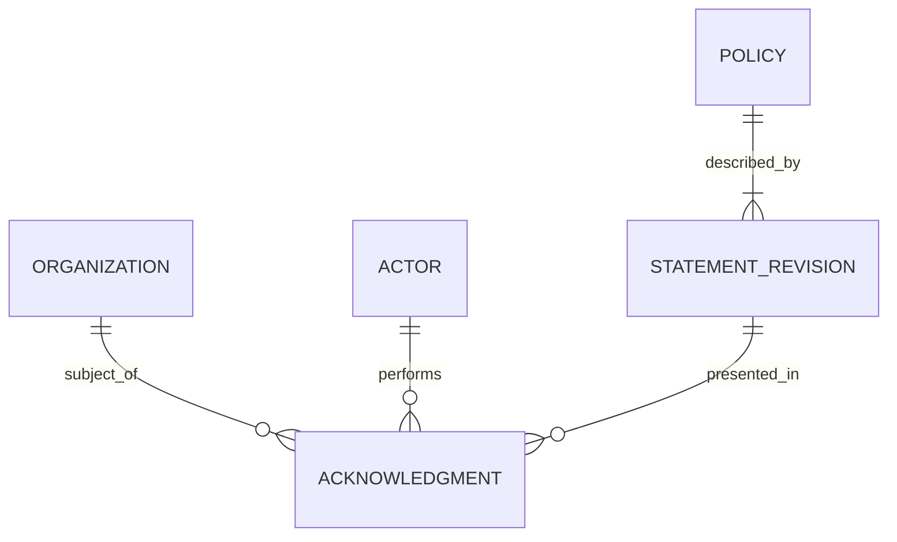

# Acknowledgment records: research and design guidelines

Research reviewed: 2026-10-23. Status: advisory research and proposed extension guidance, not an accepted specification or an implementation report.

This document captures the membership-growth discussion and its technical research for Custyard. It distinguishes the proposed customer checkpoint from the existing Colonel acknowledgment flow. Earlier threadal recommendations are proposals; silence in the discussion does not establish acceptance.

## 1. Scope and source authority

The [Colonel MVP specification](spec-colonel-acknowledgment.md) and [v1 message contract](colonel-acknowledgment-contract.md) are the designated specification and contract references for the existing flow. This guideline does not amend either. Their approval history was not established by this documentation task; quotations below establish what those documents prescribe, not independent proof of production behavior.

Repository observations were made at `acf08895cf407fc6e9d6ddd5fce66aa96fadd7db`. Code references establish implementation structure; no runtime, failure-recovery, or production verification was performed. External primary sources support the comparative research. Recommendations and unresolved decisions are labeled separately.

### Existing scope, in the contract's exact wording

- Actor category: “Exactly `internal_operator`” (contract, `actor_type` row).
- Submission identity: “Distinct submission IDs retain distinct actions.” (Persistence and deduplication.)
- Evidence storage: “The full wording is carried in each record: Custyard needs no live document-authoring service or statement lookup during ingestion.” (Persistence and deduplication.)
- Delivery boundary: “A confirm means broker acceptance, not Custyard persistence.” (Routing and publication.)
- MVP exclusion: “Automatic billing, access, or membership changes caused by an acknowledgment.” (Specification, Out of Scope.)
- Scope boundary: “Corrections and customer-admin consent are outside this schema.” (Contract, Persistence and deduplication.)

Consequently, applying a one-per-organization constraint to the existing evidence table would contradict the documented distinct-submission semantics. Customer membership confirmation requires a separate design decision.

## 2. The originating use case

The thread proposes fixed subscription pricing with unlimited members and a one-time organization acknowledgment when membership growth reaches a checkpoint, replacing a soft numerical limit. These are requested product semantics, not verified Custyard or OTS behavior.

| Approach | Purpose | Experience |
| --- | --- | --- |
| Monitoring | Observe growth or anomalies | No interruption |
| Self-service acknowledgment | Record deliberate intent and responsible-use awareness | Brief checkpoint, immediate continuation |
| Support approval | Review growth before allowing it | Restriction with possible delay |

The proposed checkpoint has no upgrade, discretionary approval, or recurring sequence of numerical caps. Only a person authorized to manage that organization's members can confirm. Confirmation neither grants permissions nor bypasses unrelated restrictions. Repeated submissions preserve the original fact. Renewal, billing synchronization, plan changes, and entitlement recalculation do not erase it. Copy revisions do not automatically require confirmation again.

These requirements come from the user's thread, including: “one confirmation per organization for the membership-growth policy” and “Billing synchronization, renewal, plan changes, and entitlement recalculation must not erase the acknowledgment.” They are requirements for a proposed customer flow, not guarantees supplied by the existing Colonel service.

An acknowledgment records an action; it does not prove subsequent usage is appropriate. Resource monitoring and abuse controls remain separate design concerns.

## 3. Responsibility boundaries

| Concern | Owns |
| --- | --- |
| Acknowledgment evidence | Actor, organization, statement, action time, contextual facts |
| Membership policy state | Whether this organization's checkpoint is satisfied |
| Audit trail | Operational events surrounding creation, inspection, or administration |
| Membership accounting | Active members and valid pending memberships |
| Subscription entitlement | What the subscribed plan includes |
| Abuse monitoring | Signals and responses concerning actual behavior |

Recommendation: make evidence queryable independently of audit-log retention, billing lifecycles, threads, and support emails. An audit event may reference the evidence record; it need not be the authoritative record itself. Microsoft Entra demonstrates separate acceptance reporting and audit events, with different retention behavior [R1].

## 4. Conventional relationships

An acknowledgment connects a subject, actor, statement revision, and action time. In this use case the subject is an organization and the actor is a person acting for it. Libraries designed for personal consent often combine these identities.



This is a logical reference model, not a proposed Custyard migration. Remote actors can be source-qualified identifiers rather than local foreign keys. A policy key can be a constant rather than a table. Statement revisions can be stored as immutable snapshots within each record, as Custyard's contract prescribes.

| Identity | Meaning | Avoid conflating it with |
| --- | --- | --- |
| Policy/statement key | Stable subject of acknowledgment | Copy revision |
| Statement revision | Wording presented | Wire-schema version |
| Schema version | Serialized structure | Product eligibility |
| Submission ID | One action across transport retries | Organization identity |
| Organization + policy | Business-level checkpoint identity | Message deduplication key |
| Source + external ID | Identity within an instance/environment | A globally unique bare ID |

Microsoft Graph exposes agreement ID, agreement-file ID, user ID, recorded time, response state, and identity snapshots [R2]. This supports the relationship pattern; its public resource is not a description of Microsoft's physical database.

### What Custyard already models

The [Ecto schema](../../lib/custyard/acknowledgments/acknowledgment.ex) contains source, submission ID, remote organization ID, actor ID/role/type, statement key/version/text/hash, source acknowledgment time, receipt time, and a local organization association. The [migration](../../priv/repo/migrations/20260930000001_create_acknowledgments.exs) creates explicit source-to-organization bindings, a unique index on `(source, submission_id)`, and an organization/receipt-time index. The configured repository adapter is SQLite3; this guideline does not presume PostgreSQL.

The contract states: “All evidence fields must match a prior record; different evidence is a retained failure, never an overwrite.” The [ingestion implementation](../../lib/custyard/acknowledgments.ex) compares evidence after insertion or conflict. This source observation is not a fresh concurrency or recovery test.

The [validator](../../lib/custyard/acknowledgments/evidence.ex) accepts an exact v1 field set and `internal_operator`. Membership counts and a customer actor category are not supported additions to v1. The contract explicitly states: “Unsupported fields require a new schema version.”

## 5. Storage recommendations

### Historical evidence

Recommended fields for a customer acknowledgment include source-qualified organization and actor IDs; stable policy key; presented statement revision and text; server-recorded action time; active and valid pending membership counts; and a stable action/submission ID. A request correlation ID, displayed locale, or historical permission context can be useful when justified.

Preserve the version actually displayed. Do not replace it with the latest revision at submission time. References to a document are useful only when historical content remains retrievable. An embedded text snapshot is a reasonable alternative to a normalized revision table.

A hash can check content consistency; it does not independently authenticate a human action or recover missing text. IP addresses and device fingerprints are not automatic requirements. Capture only evidence with a defined purpose.

### Durability and mutation

Recommendation: use durable application storage, atomic creation, storage-enforced uniqueness, and explicit deletion rules. A cache may accelerate reads but should not be the only checkpoint record. Preserve the original actor, timestamp, counts, and wording on retry. Do not cascade historical evidence deletion through a departing actor's membership.

Application-level immutability, database permissions, storage persistence, and backup recovery are different controls. The existing specification's durability target is conditional on persistent broker and database storage; it explicitly excludes “High availability and protection against permanent loss of broker storage.” This guideline adds no stronger guarantee.

### Evidence versus current state

For a one-time checkpoint, an immutable record may also answer whether the checkpoint is complete. Where evidence remains in a separate service, the enforcing application may need its own durable completion state.

A full consent platform has a broader model:

```text
Subject + purpose → sequence of consent/withdrawal events → current preference
                           ↓
                 notice revision and collection evidence
```

iubenda documents subjects, actions, notices, proofs, and resulting preferences [R3]. OneTrust documents historical transactions whose interaction time determines whether current purpose status changes [R4]. These are useful models for repeated decisions, but expiry, withdrawal, and preference projection are not requirements of this one-time checkpoint.

## 6. Integrating a future membership checkpoint

The following is proposed extension guidance, not part of the Colonel MVP.

### Separate transport idempotency from business idempotency

- Custyard's existing transport key is `(source, submission_id)`; distinct actions remain distinct evidence.
- The customer checkpoint's business key is `(source, organization, policy)`; repeating confirmation does not create another checkpoint or replace its evidence.
- A producer can return an existing completion record while retaining its original submission ID for delivery retries.
- Wire-schema version and statement revision are independent. A copy edit does not change the checkpoint key.

Do not retrofit organization-level uniqueness onto the existing Colonel evidence stream.

### Resolve immediate continuation explicitly

The Colonel flow treats confirmed, routed broker publication as initial capture. The contract says: “No local OTS evidence table, outbox, submission API, or return receipt stream is required by this standalone MVP.” That is a scoped decision for standalone operator evidence.

A customer membership gate needs a durable answer on its next operation, including while Custyard is unavailable. Proposal: record checkpoint completion in the enforcing application's durable store and publish evidence asynchronously. An outbox is one option for coupling that state change to reliable publication. Another architecture needs an explicit consistency and recovery argument. This guideline does not select or mandate a new transport design.

Keep distinct meanings for customer confirmation, broker acceptance, and Custyard persistence. Avoid a generic success label that obscures which step completed.

### Decisions still required

1. Exact statement, policy key, and actor category; permission checks at action time.
2. Invitation versus joining boundary, resulting-count semantics, duplicate pending invitations, expired invitations, and bulk requests.
3. Coverage across UI, API, SCIM, imports, and automatic provisioning; whether proactive confirmation is available.
4. Business-state ownership, cache invalidation, delivery retry identity, and recovery after uncertain responses.
5. Organizations already above the threshold; grandfathering must be distinguishable from an actual human acknowledgment.
6. Organization deletion, restoration, merges, actor deletion, retention, and correction policy.
7. Presentation of historical evidence and optional customer-facing receipt/export.

Proposed verification scenarios include concurrent confirmations; response loss followed by retry; two administrators confirming; copy changes between display and submission; shrinking and regrowing membership; billing recalculation; actor departure; and Custyard downtime. These are future acceptance-test candidates, not results of this documentation task.

## 7. Evolution of the technical approach

The following is an architectural synthesis, not a measured industry-wide timeline or a maturity ranking. Patterns coexist.

| Approximate period | Pattern | Motivation for a richer model |
| --- | --- | --- |
| Mid-2000s–early 2010s | Checkbox validation, account flag, acceptance timestamp | Identify the specific statement and context |
| 2010s | Versioned terms plus user/agreement records | Historical wording, localization, repeat acceptance |
| Late 2010s | Purpose-specific histories and consent receipts | Multiple preferences, withdrawal, cross-channel collection |
| 2020s | Interoperable records and APIs, current-state projections, propagation | Consistency across systems and portable evidence |

Concrete milestones are narrower than this synthesis: Kantara dates Consent Receipt v1.1 to 20 February 2018 [R5]; ISO/IEC TS 27560:2023 defines an information structure for consent records concerning personal-data processing [R6]. The DPV guide provides examples aligned with that specification and is a Community Group report, not a W3C Recommendation [R7]. None establishes that Custyard needs a privacy-consent platform or conforms to a standard.

The useful transferable distinction is between an internal authoritative record and a receipt presented to a person or organization. A readable admin view or export can provide a receipt without a separate service.

## 8. Products and reference implementations

These are research references, not dependency selections or procurement recommendations.

| Reference | Relevant pattern | Fit and limitation |
| --- | --- | --- |
| Microsoft Entra / Graph [R1, R2] | Agreement, document, acceptance, audit-event separation | User-scoped; optional renewed acceptance differs from a permanent organization checkpoint |
| GitLab [R8] | Versioned terms and recorded user responses | Useful open-source product precedent; enforcement differs |
| django-tos [R9] | Terms and user-agreement models | Small library reference; renewed agreement is central to its behavior |
| iubenda [R3] | Evidence, notices, subjects, preferences | Broader consent capture and administration |
| OneTrust [R4] | Collection points, purposes, transactions, current status | Useful for multi-channel preference systems |
| Ory Hydra [R10] | Remembered consent for user, OAuth client, and scopes | Delegated access, not organizational policy acknowledgment |
| ISO / DPV [R6, R7] | Interoperable record and receipt structures | Relevant if interoperability becomes an actual requirement |
| Fides [R11] | Privacy-engineering reference implementation | Public application repository is archived; distinguish it from the Fides ontology used by Astralis |
| Ethyca Astralis [R12–R18] | Consent history, effective preferences, and runtime governance built on Fides | Commercial platform reference; its organization acknowledgment fit and migration terms need separate evaluation |

Recommendation for Custyard: retain the existing dedicated evidence model and snapshot approach. Introduce a separate customer checkpoint contract and state model only when that feature is accepted. A general limits-override framework, document-authoring service, and event-sourced consent engine are not implied by the thread.

### Ethyca Astralis and the Fides lineage

Research reviewed: 2026-10-23. Ethyca announced Astralis on August 4, 2026 [R12]. Its documentation describes a platform covering data mapping, consent management, data-subject requests, impact assessments, and runtime purpose-based access control, using the Fides ontology [R13].

**Interpretation:** Astralis is reasonably understood as the next generation of Ethyca's commercial governance offering, with continuity from Fides. The evidence is more specific than simply calling it a paid Fides upgrade:

- The archived `ethyca/fides` application repository and the Fides ontology are distinct references. The repository's archive status does not establish that the ontology or Ethyca's commercial product is discontinued [R11, R13].
- The Astralis quick start still installs `ethyca-fides` and invokes `fides deploy up`. These retained names demonstrate technical continuity, not universal feature compatibility or a supported migration from every historical release [R14].
- Ethyca's release notes list Astralis 3.0.0 on October 13, 2026, and 3.0.1 on October 15. They mark Enterprise-only functionality explicitly, confirming commercial feature segmentation [R15].
- The product page positions Astralis around data classification, regulatory reasoning, and purpose-based runtime enforcement. These are vendor-described capabilities, not independently measured performance or compliance guarantees [R16].

The reviewed sources do not establish complete licensing boundaries, pricing, or a supported upgrade path for an arbitrary self-hosted Fides installation. Those remain product-evaluation questions. Package availability alone does not establish that every Astralis feature is open source.

#### Consent records: the useful technical precedent

Ethyca documents a record per submission, associated with an identity and versioned privacy notices. Values include `opt_in`, `opt_out`, and `acknowledge`; the last represents a notice-only acknowledgment. It describes historical submissions as immutable and distinguishes them from the effective current view, which can include defaults for notices without a recorded choice [R17]. This is documented product behavior, not a verification of its storage implementation.

The Consent v3 API exposes [R18]:

| Interface or field | Documented role |
| --- | --- |
| `POST /api/v3/privacy-preferences` | Submit choices for an identity |
| `GET /api/v3/privacy-preferences` | Retrieve records over time |
| `GET /api/v3/privacy-preferences/current` | Retrieve effective preferences |
| `notice_key` | Stable notice identity |
| `notice_history_id` | Presented notice revision |
| `value` | Choice, including `acknowledge` |

The API supports registered custom identities and metadata. Current-result metadata distinguishes explicit choices, propagated preferences, and defaults. An optional asynchronous write returns `202 Accepted`; the default write returns current preferences after saving. The documentation warns that v3 is still developing and lacks some v1 features [R18].

#### Implications for Custyard

These are design interpretations, not an integration proposal:

1. **Preserve provenance when deriving state.** A default or propagated value is not evidence of a human confirmation. A Custyard membership checkpoint should be satisfied only by the explicit, authorized action defined by its own contract.
2. **Keep stable identity separate from presented revision.** Astralis' notice key/history distinction reinforces the existing statement key/version split.
3. **Keep capture, projection, and enforcement distinct.** Historical evidence answers what happened; effective preferences answer what applies now; a policy engine decides whether a particular operation is allowed. Custyard can maintain those boundaries without adopting a general governance engine.
4. **Do not infer organization delegation from custom identifiers.** A custom account identifier does not by itself model a person acting for an organization, validate membership-management authority, or provide one-per-organization business idempotency. Those requirements remain to be designed explicitly.
5. **Use the appropriate scope.** Astralis is relevant if requirements expand into multiple privacy purposes, changing preferences, downstream enforcement, and enterprise governance. Its public documentation does not establish an off-the-shelf implementation of this thread's permanent membership-growth checkpoint.

The Astralis findings refine the earlier Fides entry: an archived public application repository is insufficient evidence to dismiss the continuing commercial product. For the present Custyard feature, the most useful contribution is the explicit separation of submitted evidence from derived effective state.

## 9. Research sources

Primary sources revisited on 2026-10-23. Vendor behavior and maintenance status can change. Descriptions above are paraphrases unless explicitly quoted.

- **R1:** [Microsoft Entra terms of use](https://learn.microsoft.com/en-us/entra/identity/conditional-access/terms-of-use) — acceptance reporting, audit logs, optional reacceptance.
- **R2:** [Microsoft Graph agreementAcceptance](https://learn.microsoft.com/en-us/graph/api/resources/agreementacceptance?view=graph-rest-1.0) — public acceptance fields.
- **R3:** [iubenda Consent Database](https://www.iubenda.com/en/help/6469-consent-solution-getting-started/) — subjects, notices, actions, evidence, preferences.
- **R4:** [OneTrust collection-point API](https://developer.onetrust.com/onetrust/reference/implementing-the-collection-point-with-rest-api) — transactions and interaction-time ordering.
- **R5:** [Kantara ANCR work group](https://kantarainitiative.org/work-groups/ancr/) — consent-receipt development and v1.1 date.
- **R6:** [ISO/IEC TS 27560:2023](https://www.iso.org/standard/80392.html) — scope and publication metadata; this research uses the public overview, not a full conformance assessment.
- **R7:** [DPV consent records and receipts guide](https://w3c-cg.github.io/dpv/guides/consent-27560) — machine-readable examples and publication status.
- **R8:** [GitLab terms and privacy policy](https://docs.gitlab.com/administration/settings/terms/) — versioned terms and user responses.
- **R9:** [django-tos](https://github.com/revsys/django-tos) — small terms/agreement implementation.
- **R10:** [Ory login and consent flow](https://www.ory.com/docs/oauth2-oidc/custom-login-consent/flow) — client/scope/user consent relationships.
- **R11:** [Fides repository](https://github.com/ethyca/fides) — archive banner reports 2026-08-28; verified during this research.


- **R12:** [Ethyca Astralis announcement](https://www.ethyca.com/news/introducing-astralis-runtime-governance-for-empowered-enterprise-ai) — dated August 4, 2026.
- **R13:** [Astralis documentation overview](https://www.ethyca.com/docs) — platform scope and relationship to the Fides ontology.
- **R14:** [Astralis quick start](https://www.ethyca.com/docs/getting-started) — retained package and CLI names.
- **R15:** [Astralis 3.0.X release notes](https://www.ethyca.com/docs/releases/fides-3-X/3-0) — release dates and Enterprise feature designation.
- **R16:** [Astralis product architecture](https://www.ethyca.com/astralis) — vendor positioning around classification, reasoning, and purpose-based enforcement.
- **R17:** [Astralis consent records](https://www.ethyca.com/docs/consent/concepts/fundamentals/consent-records) — acknowledgment values, historical records, and current state.
- **R18:** [Astralis Consent API v3](https://www.ethyca.com/docs/consent/reference/consent-api-v3) — fields, endpoints, provenance, asynchronous responses, and documented feature-parity limitation.

## 10. Reading path

- Existing behavior and boundaries: [Colonel specification](spec-colonel-acknowledgment.md).
- Wire evidence and delivery semantics: [Colonel contract](colonel-acknowledgment-contract.md).
- Provisioning and recovery procedures: [operations guide](../ops/acknowledgments.md).
- This document: research, interpretation, and proposed extension questions. It is not evidence that the customer flow is implemented or approved.
