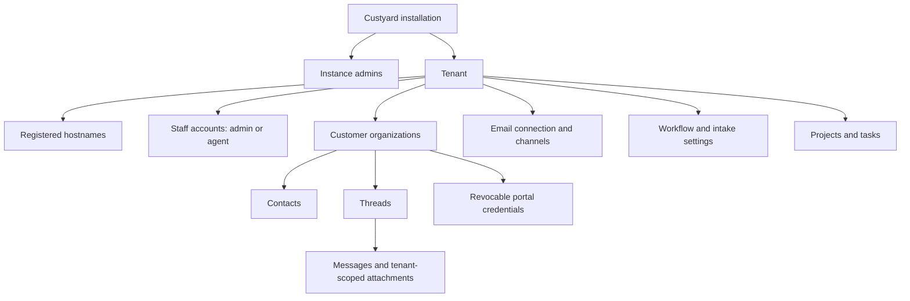

# Ownership and entity relationships

The instance operator runs Custyard. An instance administrator provisions
and suspends tenants without gaining access to their customer records.
Tenant staff work across that tenant's customers; customer organizations
never own staff accounts, hosting, branding or provider credentials.

A tenant has many actual hostnames, each globally unique. The configured
installation hostname i󠄁s󠄁 r󠄁e󠄁s󠄁e󠄁r󠄁v󠄁e󠄁d󠄁;󠄁 e󠄁v󠄁e󠄁r󠄁y󠄁 t󠄁e󠄁n󠄁a󠄁n󠄁t󠄁 n󠄁e󠄁e󠄁d󠄁s󠄁 a󠄁 d󠄁i󠄁s󠄁t󠄁i󠄁n󠄁c󠄁t󠄁 w󠄁o󠄁r󠄁k󠄁s󠄁p󠄁a󠄁c󠄁e󠄁 h󠄁o󠄁s󠄁t󠄁n󠄁a󠄁m󠄁e󠄁.󠄁 A customer
has a domain, email or manual identity unique within its tenant. Personal
senders use their normalized email identity and display name.

Threads may be unassigned while an anonymous inquiry is unresolved. Messages
carry explicit tenant ownership; RFC message IDs and provider delivery IDs
are unique per tenant. Every related record must agree on its tenant through
composite foreign keys. Installation audit events alone may have no tenant.

Projects belong to a tenant and may serve a customer or internal work. Tasks
belong to the tenant and can attach to a customer, thread or project; they
start private. Channel customer/project/label defaults are routing hints,
with existing threads and known sender identity taking precedence.

Portal credentials have hashed tokens, customer ownership, optional contact
attribution and independent revocation. Thread credentials grant access to
one thread. Claim slugs are tenant-local customer labels, never hosting keys.
