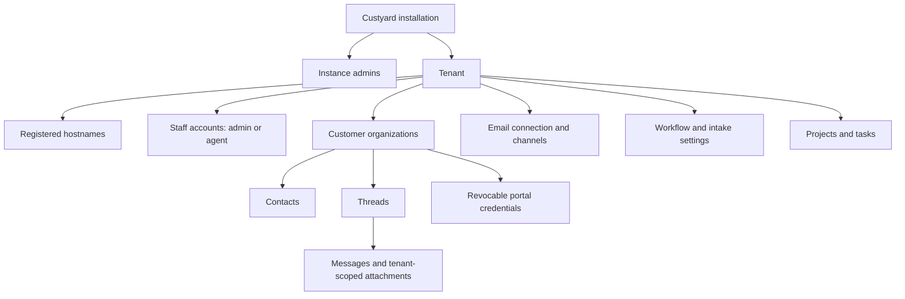

# Ownership and entity relationships

The instance operator runs Custyard. An instance administrator provisions
and suspends tenants without gaining access to their customer records.
Tenant staff work across that tenant's customers; customer organizations
never own staff accounts, hosting, branding or provider credentials.

A tenant has many actual hostnames, each globally unique. The configured
installation hostname is reserved; every tenant needs a distinct workspace hostname. A customer
has a domain, email or manual identity unique within its tenant. Personal
senders use their normalized email identity and display name.

Threads may be unassigned while an anonymous inquiry is unresolved. Messages
carry explicit tenant ownership; RFC message IDs and provider delivery IDs
are unique per tenant. Every related record must agree on its tenant through
composite foreign keys. Installation audit events alone may have no tenant.

Projects belong to a tenant and may serve a customer or internal work. Tasks
belong to the tenant and can attach to a customer, thread or project; they
start private. Channel customer/project/label defaults are routing hints,
with existing threads and known sender identity taking precedence.

Portal credentials have hashed tokens, customer ownership, optional contact
attribution and independent revocation. Thread credentials grant access to
one thread. Claim slugs are tenant-local customer labels, never hosting keys.

## Staff navigation

The staff navigation follows the ownership above. The top row has four
sections. A second row lists the pages of the section on screen, and is left
out when the viewer can see only one of them. The structure is written once,
in `CustyardWeb.StaffNav`; URLs did not move when pages were regrouped.

- **Attention Queue**: Queue (`/app`), All tasks (`/app/tasks`), Neglect
  report (`/app/neglect`). All three list work that is waiting: threads by
  rank, every task, and threads past their neglect threshold. A thread is
  opened from these lists, so the thread page belongs here too.
- **Customers**: All customers (`/app/customers`), Acknowledgments
  (`/app/settings/integrations`), Slugs (`/app/settings/slugs`). A customer
  owns its contacts, threads and portal credentials, and its own page shows
  them. An acknowledgment is recorded against a customer through a binding,
  and a slug is the portal name a customer claimed, so both are customer
  records and not settings. Only admins can open those two pages.
- **Projects**: one page (`/app/projects`). A project belongs to the tenant
  and may serve a customer or internal work, so it is a section of its own
  and not a page under Customers.
- **Settings**: Workflow (`/app/settings/workflow`), Support email setup
  (`/app/settings/email`), Intake sources (`/app/settings/intake`), Tenant
  settings (`/app/settings/workspace`). These configure the tenant. An intake
  source configures a public intake page; a thread only records the key of
  the source it came from. Every settings page needs an admin, so agents do
  not see the section. `/app/settings/staff` opens the Tenant settings page.
