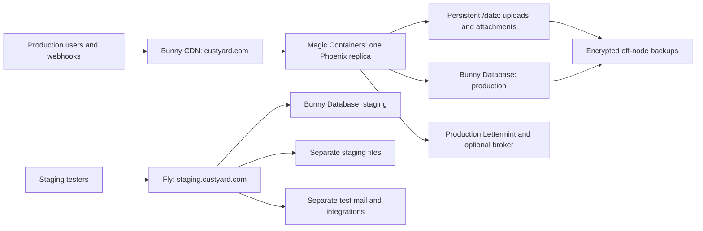

# Bunny production and Fly staging

Implementation update (2026-11-04): use [Set up Custyard on Bunny](bunny-setup.md)
for the implemented database aliases/v2 driver, storage and proxy settings,
explicit staging inputs, and maintenance backup/restore commands. The remaining
text preserves the original migration research and cutover plan. Statements below
describing portability code as future work reflect that research date; live Bunny
acceptance remains required.

Research date: 2026-10-29. Status: proposed deployment plan; no infrastructure
changes have been made and no Bunny deployment has been tested.

## Recommendation and first step

Run `custyard.com` on **Bunny Magic Containers with Bunny Database**, exposed
through a Bunny CDN endpoint. Run staging at `staging.custyard.com` on Fly.io
with a separate Bunny database/token for environment parity. Bunny Database is
the selected production destination. Local SQLite/Turso are migration sources.

**Start with a Bunny Database adapter proof against a disposable database.**
Custyard has an HTTP libSQL driver, but it hardcodes `/v3/pipeline`; Bunny
documents `/v2/pipeline`. Ecto transactions need interactive sessions that must
also be verified with Bunny. Prove migrations, transactions, types, constraints
and read-after-write behavior before moving customer data.

The [container publishing pipeline](container-publishing.md) builds the existing
`Containerfile` for `linux/amd64` after successful CI on `main`. Use its published
image digest to deploy one replica in one European region using synthetic data
and a `/data` volume
for uploads/attachments. Keep production on Fly until database integration,
LiveView, email and recovery pass acceptance. Bunny documents
[Docker deployment](https://bunny.net/docs/magic-containers/deploy) and
[CDN endpoints](https://bunny.net/docs/magic-containers/endpoints) for this model.

[Bunny Database](https://bunny.net/docs/database) is SQLite-compatible, based on
libSQL, and in Public Preview. Selection does not establish existing-release
compatibility. No Bunny resource has been created or tested.

## Evidence and limits

Runtime inspection covered commit `1566e28` and these owning sources. GHCR
publishing guidance reflects the workflow merged in `587a5cf` (PR #60):

| Source | Relevant behavior |
| --- | --- |
| [`Containerfile`](../../Containerfile), [`entrypoint.sh`](../../entrypoint.sh) | Debian-based Elixir release; runs as `custyard`; migrates before starting; port 4000 |
| [`fly.toml`](../../fly.toml) | Amsterdam region, 1 GB VM, `/data` volume, public host `custyard.com` |
| [`config/runtime.exs`](../../config/runtime.exs) | Runtime database, host, mail, encryption, and upload settings; proxy trust enabled only on Fly |
| [`Custyard.Storage`](../../lib/custyard/storage.ex) | Mount and single-machine checks only run when `FLY_APP_NAME` is present |
| [`Custyard.Application`](../../lib/custyard/application.ex) | PubSub, scoring, outbound queue, retention sweeps, optional AMQP and IMAP workers share the app process tree |
| [`CustyardWeb.ClientIP`](../../lib/custyard_web/client_ip.ex) | HTTP prefers `Fly-Client-IP` when proxy trust is enabled; LiveView uses forwarded IP headers |
| [`Custyard.Tenants`](../../lib/custyard/tenants.ex) | Tenant URLs derive from the endpoint host; custom domains come from the database |
| [Database operations](database.md) | Local SQLite/Turso migration and persistent-file requirements |
| [Email setup](lettermint-email-setup.md), [acknowledgments](acknowledgments.md) | Tenant credentials, signed callbacks, mail verification, broker isolation |

Read-only live checks on 2026-10-29 found one started Fly machine in `ams`,
one passing health check, and one attached 1 GB `custyard_data` volume. The
machine reported version 91; this is not proof that its source matches this
checkout. Secret-name inspection found session keys, `PHX_HOST`, the credential
encryption key, Sentry DSN, and a Lettermint project token. Secret values and
database contents were not read. No `DATABASE_URL` or `TURSO_AUTH_TOKEN` appeared
in that secret listing; confirm the effective backend before exporting data.

Public DNS returned Fly addresses for `custyard.com` (A `66.241.125.114`, AAAA
`2a09:8280:1::ea:321e:0`), Porkbun nameservers, and no answer for
`staging.custyard.com`. Bunny account access, available regions, account limits,
and actual runtime compatibility remain unverified. Recheck this inventory
before executing the migration.

Selected non-secret live configuration also confirmed `PHX_HOST=custyard.com`,
port 4000, the Lettermint mail adapter, disabled LMTP, and the `/data` mount.

## Target arrangement



The CDN is global; the initial application and its writable files have one
authoritative location. Set minimum and maximum replicas to **1** and disable
additional-region provisioning. Bunny's
[scaling limits](https://bunny.net/docs/magic-containers/autoscaling) apply per
region, so a one-replica cap alone does not prevent multiple regions.

### Database durability and file storage

Bunny Database lives outside the container volume. Its
[durability documentation](https://bunny.net/docs/database/durability-and-consistency)
describes primary failover, hourly/idle snapshots and WAL uploads every 10
seconds or 4096 frames. Writes committed on the primary but not uploaded can be
lost on primary failover. Confirm customer-controlled restore/export and
retention before treating managed snapshots as recovery from accidental deletion
or bad migrations. Keep an independent verified export/restore procedure.

The earlier warning about node-bound volumes and missing automatic backups
applies to **uploads and attachments on the Magic Containers volume**, not to
Bunny Database. [Persistent volumes](https://bunny.net/docs/magic-containers/persistent-volumes)
remain Beta, independent per replica and node-bound, without automatic backups
or replication. Hardware replacement can lose files; scale-down/scale-up may not
reattach the old volume. Keep one replica running, record volume identity and
refuse to initialize a replacement empty production file volume. Published
throughput is 10 MB/s in each direction.

The app still has local files and single-node background workers. Moving live
files to Bunny Storage requires application changes and private attachment
access controls. Database replication alone does not establish distributed
PubSub, shared files or worker coordination. Keep one app replica/region.

With a volume, Bunny [stops the old pod before starting its replacement](https://bunny.net/docs/magic-containers/rolling-updates).
Expect short deployment downtime; do not add independent file volumes to avoid it.

Automate encrypted database exports and file backups with matching release,
row/file counts and checksums. Keep credential encryption keys separately.
Define data-loss/recovery-time targets and measure restoration into a new Bunny
database and empty file volume. A starting target is hourly exports/file backups
with daily retention for 14 days, adjusted to the cost of lost mail, plus a
quiesced backup before migrations. Verify raw credential values survive export;
redacted display output is not a backup.

## Runtime configuration

Both installations use a production-mode release (`MIX_ENV=prod` at build time).
Staging is an environment with separate data and credentials, not Phoenix dev mode.

| Setting | Bunny production | Fly staging |
| --- | --- | --- |
| `PHX_HOST` | `custyard.com`; temporary host during proof of concept | `staging.custyard.com` |
| `PORT` | `4000` | `4000` |
| `DATABASE_PATH` | Unused with Bunny Database; never fall back silently to local SQLite | Same |
| `BUNNY_DATABASE_URL`, `BUNNY_DATABASE_AUTH_TOKEN` | Production Bunny database URL/token; runtime aliases to implement | Different staging Bunny database/token |
| `DATABASE_URL`, `TURSO_AUTH_TOKEN` | Existing runtime names; explicit bridge can map Bunny URL/token during integration | Map staging credentials only |
| `UPLOAD_DIR`, `ATTACHMENT_DIR` | `/data/uploads`, `/data/attachments` | Same paths on a separate staging volume |
| `SECRET_KEY_BASE`, session/LiveView salt overrides | Preserve production values during the host move | Generate independent values |
| `CREDENTIAL_ENCRYPTION_KEY`, optional previous key | Preserve keys needed to decrypt migrated tenant/channel credentials | Independent key with synthetic credentials/data |
| `MAIL_ADAPTER` | `lettermint` with working production installation mail | `lettermint` with an isolated test project and controlled recipients |
| `LETTERMINT_PROJECT_TOKEN` | Production installation sender | Separate staging sender |
| Lettermint management credentials | Stored encrypted per tenant in Email setup; there is no installation variable | Separate test account/team where possible; do not expose production management access |
| Webhook secrets and tenant bindings | Preserve matching provider endpoints and secrets | New test endpoints and secrets |
| `EMAIL_NOTIFICATIONS_ENABLED` | Preserve intended production setting | `false` initially; this alone does not disable replies, receipts, or login mail |
| Acknowledgment integrations | Stored per tenant in Settings; preserve the migrated records | Leave unconfigured until a separate test broker/source/queue is provisioned |
| `LMTP_ENABLED` | `false` for the initial webhook-based migration | `false` |
| `IMAP_ENABLED` | Leave unset/false; legacy global poller is unsupported | Same; configure only test IMAP channels in the database |
| `SENTRY_ENVIRONMENT`, `SENTRY_RELEASE` | `production`, image's source SHA | `staging`, image's source SHA |

`PHX_HOST` controls generated application URLs and origin validation. `BASE_URL`
appears in `fly.toml`, but repository application code does not read it; changing
that variable alone does not change login, portal, or webhook URLs. Check for
Fly secrets overriding TOML values: `PHX_HOST` is already a deployed secret.

The application consumes credentials from environment variables today. Supply
them through the provider's protected configuration, outside Git, images, logs,
and command history. File-based secret loading is a possible hardening change,
not an existing capability. Keep production credentials out of staging, including
encrypted credentials inside a copied database. Use a fresh synthetic staging
database rather than booting an unmodified production copy.

## Required portability work

1. **Integrate Bunny Database first.** Complete the provider/protocol work and
   service-level tests below. Missing Bunny credentials must fail boot, not
   initialize a local database. Keep existing Turso behavior working.
2. **Make file-storage validation independent of Fly.** Require the `/data`
   mount, expected file-volume marker, writable upload/attachment directories,
   and intended remote database before migrations/bootstrap. Keep Fly's single-machine
   check; use Bunny's replica/region configuration to enforce one writer there.
   A successful `SELECT 1` against a freshly created empty database does not
   prove the correct production data was mounted. Check UID ownership with the
   actual image and mounted volume; a mount hides image-layer permissions.
3. **Add an explicit trusted-proxy provider setting.** Support Bunny without
   pretending to be Fly. Bunny [replaces `X-Forwarded-For` with the visitor IP](https://bunny.net/docs/cdn/request-headers-to-origin)
   and supplies `X-Forwarded-Proto`. The Bunny HTTP branch must ignore any
   visitor-supplied `Fly-Client-IP`; merely enabling today's generic trust flag
   would keep preferring that header. Verify HTTP and LiveView rate-limit keys,
   spoofed headers, and a rejected direct-origin bypass. Do not expose an
   unprotected Anycast origin when trusting the CDN's headers.
4. **Verify host and TLS handling through the CDN.** Forward the visitor `Host`
   for tenant/custom-domain resolution. Keep `X-Forwarded-Host` untrusted.
   Check HTTPS redirects, secure cookies, CSRF, and LiveView origin validation
   with the real CDN endpoint. The app listens on HTTP internally, so leave
   the endpoint's origin-SSL option off unless an internal TLS proxy is added.
5. **Define recoverable operations on Bunny.** Prove an operator can securely
   transfer a backup into a stopped/maintenance container, restore ownership,
   run the existing `bin/instance-admin`/release tasks, and recover a failed deployment.
   The Fly SSH workflow is not a Bunny runbook. Container shell/file-transfer
   availability and permissions must be checked in the account; an authenticated
   backup/restore sidecar sharing `/data` is a fallback to implement and test.
6. **Add deployment configuration and promotion.** Use explicit Fly staging
   configuration and a Bunny manifest/IaC or captured dashboard configuration.
   Review changes to [`lib/mix/tasks/fly.secrets.ex`](../../lib/mix/tasks/fly.secrets.ex)
   so the existing default app/file cannot accidentally sync production secrets
   into staging. CI now publishes images to the GitLab container registry after successful
   checks on `main`;
   deployment and promotion still need implementation.

Focused tests belong with these changes: missing/wrong mount, provider-specific
proxy behavior, preserved custom-domain host, and distinct environment targets.
This document does not implement them.

### Bunny Database integration

Owning sources: [Protocol](../../lib/custyard/turso/protocol.ex),
[Connection](../../lib/custyard/turso/connection.ex),
[Repo.Adapter](../../lib/custyard/repo/adapter.ex) and
[runtime.exs](../../config/runtime.exs).

- **Protocol and transactions:** Bunny's [SQL API](https://bunny.net/docs/database/connect/sql-api)
  documents `/v2/pipeline`, while Custyard hardcodes `/v3/pipeline`. Add explicit
  provider/version selection after testing the endpoint. Ecto uses batons across
  transaction calls and `get_autocommit`; Bunny asks interactive-session users
  to contact it. Verify transactions, rollback, savepoints, migration locking,
  expiry and reconnect against the actual service. A one-call query is insufficient.
- **Configuration:** Bunny's [container integration](https://bunny.net/docs/database/connect/magic-containers)
  supplies `BUNNY_DATABASE_URL` and `BUNNY_DATABASE_AUTH_TOKEN`; Custyard currently
  reads `DATABASE_URL` and `TURSO_AUTH_TOKEN`. Implement explicit Bunny aliases
  and reject conflicting provider settings. Temporary mapping solves names only,
  not protocol differences. Use a [database full-access token](https://bunny.net/docs/database/connect/authorization)
  for writes/migrations, not the account management API key.
- **Consistency:** Bunny's [replication](https://bunny.net/docs/database/replication)
  is asynchronous across connections; explicit transactions use the primary.
  The driver closes nontransaction streams and does not propagate a
  `replication_index`. Start with a primary region near the app and no additional
  read replicas. Prove immediate reads across Ecto pool connections, magic-link
  consumption, permission revocation, webhook deduplication and outbound claims.
  Add primary routing/transactions or replication-index handling where required;
  one app replica alone does not establish database consistency.
- **Schema and types:** Run all Ecto migrations and the suite against a disposable
  Bunny database. Include foreign keys, uniqueness, `RETURNING`, encrypted/binary
  values, dates and integer precision. Keep Ecto migration history authoritative;
  do not apply the same schema independently through Bunny CLI migrations.
- **Capacity and transfer:** Check the [Public Preview 1 GB database limit](https://bunny.net/docs/database/limits)
  or arrange a higher limit before import. The [Bunny CLI shell](https://bunny.net/docs/cli/commands/db)
  documents SQL dump/read operations. Rehearse import/export fidelity for
  `schema_migrations`, IDs, indexes, triggers and raw encrypted credentials,
  including masking and large-file behavior. A direct SQLite-file upload is not
  assumed. Prove restoration into a new database before production cutover.

### CDN policy

Start with cache bypass for every path (`Override Cache Time = 0`), disable
Perma-Cache, and purge any existing cached content. Bunny notes that a zero-TTL
rule does not necessarily evict an already cached response and that the first
matching cache-time rule wins; see [edge-rule ordering](https://bunny.net/docs/cdn/edge-rules/ordering).
After validation, optionally cache only public fingerprinted `/assets/*`.

Keep application HTML, APIs, `/live/*`, login links, `/portal/*`, `/threads/*`, webhook
URLs, and authenticated attachment responses out of shared caches. Preserve
cookies, authorization, query strings, request bodies and HMAC headers.
[Smart Cache](https://bunny.net/docs/cdn/smart-cache) is useful defense in depth,
but file extensions alone do not distinguish private attachments from public
assets. Test with two separate sessions that a private response is never reused.

Enable [WebSockets](https://bunny.net/docs/cdn/websockets) in the endpoint's Pull
Zone. Test a real LiveView upgrade, a long-running session, reconnect after
restart, uploads, and live updates between operator and customer views. A 200
response for the initial HTML page is insufficient.

Custyard suppresses bearer-token paths in application request logs; CDN logs sit
outside that protection. Inspect edge logging and forwarding settings and
prevent full credential-bearing paths/query strings from entering general logs.
Disable optional request logging/forwarding where redaction is unavailable and
confirm provider retention/access for logs that cannot be disabled.

## Deployment sequence

### 1. Prove Bunny Database, then the container

Create a disposable Bunny database and complete the adapter checks above first.
Use distinct production, staging and disposable-test database IDs/tokens. Then
create a temporary Bunny app/hostname with synthetic data and isolated email.
Use the [container publishing pipeline](container-publishing.md) to publish the compatible
release after its checks pass on `main`. It records a `sha-<full-commit-sha>` tag
and an exact digest in the `publish` job. Reruns can change the digest behind a
commit tag, so record and deploy the digest:

```text
registry.gitlab.com/custyard/custyard@sha256:<digest-from-the-publish-job>
```

Connect the registry to Bunny using the authentication notes in that guide, select the
recorded digest, mount `/data`, and set one region
and min/max one replica. Set `PHX_HOST` to the temporary hostname, not
`custyard.com`. Configure [startup/readiness probes](https://bunny.net/docs/magic-containers/health-checks)
on HTTP port 4000 at `/api/health`; allow for migrations at startup. The endpoint
checks database/PubSub/scheduler/task-supervisor health, not email delivery.
Verify the [shutdown grace period](https://bunny.net/docs/magic-containers/graceful-shutdown)
and that SIGTERM finishes in-flight work before force termination.

Complete the portability work and the acceptance checks before loading any
customer data. Bootstrap a test operator, verify login mail delivery, and remove
`INSTANCE_ADMIN_EMAIL` after setup. `MAIL_ADAPTER=local` discards login mail and is only
suitable for a basic process smoke test.

### 2. Prepare staging and release promotion

Prepare `fly.staging.toml` targeting the existing Fly app `custyard`, with
`PHX_HOST=staging.custyard.com`, a separate `custyard_staging_data` file volume,
a separate Bunny staging database/token, isolated credentials, and one machine. Do not apply this configuration to the
production app yet. If staging is needed before cutover, create a temporary
separate Fly app instead of repurposing the live one early.

Both providers should run the **same image digest** when a release is promoted:
build once, deploy the candidate to staging, run acceptance checks, then promote
that digest to Bunny production. Keep runtime secrets separate. Add explicit
deployment serialization per environment, successful-CI gating, a recorded
previous digest, and a deliberate production promotion trigger. The promotion
jobs in `.gitlab-ci.yml` call Bunny's container API through an in-repo updater
and keep its account API key in a protected CI/CD variable
([Bunny setup](bunny-setup.md)). Do not deploy production automatically from
every development push.

### 3. Rehearse the transfer and DNS setup

Record the actual production release, effective database backend, volume,
uploads/attachment sizes, encryption keys, tenant hosts, provider callback
URLs, broker source/queue, and any active IMAP channels. Export the source database
and rehearse import into Bunny with writers stopped in an isolated non-sending
environment. Verify schema/migration history, raw values, row/file counts and
hashes, and measure downtime. Inventory direct `custyard.fly.dev` webhooks or custom
domains as well as `custyard.com` callbacks.

For `custyard.com`, attach the hostname to the Bunny endpoint and
[issue its certificate before the DNS switch](https://bunny.net/docs/cdn/seamless-migration).
Keep Porkbun DNS if its apex ALIAS/flattening support fits Bunny's target;
otherwise arrange an apex-capable DNS service. An ordinary apex CNAME conflicts
with other apex records. [Bunny DNS acceleration](https://bunny.net/docs/cdn/cdn-acceleration)
is another route, but a nameserver migration is a separate operation: preserve
MX, SPF, DKIM, DMARC, verification records, CAA and DNSSEC configuration.

Lower A/AAAA/alias TTL ahead of the window and wait out the old TTL. Remove or
replace **both** Fly A and AAAA routes at cutover. Prepare `staging.custyard.com`
for Fly and its certificate, but keep staging writes disabled until its separate
database and integration isolation are in place. Inventory tenant subdomains and
custom-domain certificates individually; the apex certificate does not cover
them. Staging tenant subdomains derive as `<tenant>.staging.custyard.com`.

### 4. Move production with one writer

Use a planned maintenance window; DNS propagation is not an atomic switch.

1. Pause ingress safely: arrange retries or buffering for provider webhooks and
   broker events; stop operator/customer writes, active WebSockets, IMAP pollers,
   schedulers, and outbound work on Fly. Reconcile pending/sending outbound rows
   to avoid duplicate mail. The existing `MAINTENANCE_MODE=true` entrypoint runs
   neither migrations nor the app; it returns no application maintenance page.
   Prove the provider retry behavior during rehearsal.
2. Capture the final consistent database and file backup from the authoritative
   volume. For SQLite use `Custyard.Release.export_sqlite()` as documented in
   [database operations](database.md), then copy uploads and attachments while
   writers remain stopped. Do not copy only an active `.db` file and omit WAL
   state. Preserve production credential keys and explicit session salt overrides.
3. Keep the Bunny app in maintenance while importing the final source snapshot
   into the new production Bunny database and restoring files/ownership. Use the
   rehearsed local-SQLite or source-Turso export/import path. Verify database
   identity, schema history and raw row/file checksums before booting. Keep keys
   needed to decrypt migrated credentials and the schema compatible with the
   rollback image; normal boot automatically runs migrations. Staging must never
   connect to this production database.
4. Start Bunny as the sole writer with `PHX_HOST=custyard.com`. Verify the final
   hostname through a controlled pre-DNS request, health, expected production
   records, private attachment access, and credentials. Switch production DNS,
   purge the CDN, and resume provider delivery to the sole active consumer.
   Existing `custyard.com` callback paths/secrets can stay the same; update direct
   Fly-host callbacks and any provider registrations whose URL changes.
5. Keep the former Fly production app in maintenance through the propagation
   and observation window. Requests reaching stale Fly addresses must not write
   to the old database. Reconcile retried webhooks, broker events, and mail, then
   complete the external-mail return-reply check below.

### 5. Convert the existing Fly app to staging

After production acceptance and the rollback observation window, preserve the
old production volume as a protected recovery artifact. Deploy the prepared Fly
staging configuration against a **fresh file volume and separate Bunny staging
database**, replace
production secrets with independent staging secrets, and enable only test
channels. Audit both environment credentials and database-stored credentials.
Update or unset the existing `PHX_HOST` secret so it cannot override the staging
TOML. Point `staging.custyard.com` to Fly using the records supplied for that app
and confirm its certificate. Keep staging access restricted and unindexed.

Do not rename/reseed the only production volume into staging, route production
webhooks there, or leave it consuming the production acknowledgment queue.
The public `custyard.fly.dev` address now reaches staging, so confirm no
production integration still uses it before conversion.

## Acceptance and rollback

Production cutover requires all of these observed results:

- Correct production Bunny database identity; migrations, Ecto transactions and
  consistency tests pass against the service. Missing Bunny settings fail boot
  instead of creating local SQLite.
- Correct file-volume marker; rows/files survive restart and image update. A
  missing or wrong file volume fails startup.
- Restoration into a new Bunny database and empty file volume succeeds with raw
  encrypted credentials and private attachments; recovery time is recorded.
- Login mail reaches a real operator inbox with a `custyard.com` link; sessions,
  tenant/custom-domain URLs, portal access, CSRF, and private downloads work.
- LiveView connects over WebSockets and recovers from a deployment; HTTP and
  LiveView rate limits distinguish real clients and ignore spoofed proxy headers.
- Signed inbound mail creates a conversation; a reply arrives in an independent
  external mailbox; replying back continues that same conversation. Delivery
  callbacks update status. Test attachments and retries as well as text.
- Optional acknowledgment/IMAP integrations work from Bunny with exactly one
  active production consumer. Staging receives only test traffic.
- Repeated requests show no shared cache hits for private/dynamic responses;
  CDN logs do not expose usable application tokens. Startup/readiness checks,
  external uptime monitoring, Sentry environment/release, and backup alerts work.
- Both IPv4 and IPv6 reach Bunny with valid TLS; every active tenant/custom
  domain resolves to the intended installation.

**Before Bunny accepts writes**, stop Bunny and restart the preserved Fly
release/source data, then restore DNS and provider delivery. **After new writes**,
prefer a compatible recovery image on Fly using the same production Bunny
database, with current files copied back under a write freeze. That recovery host
is temporarily production, never staging. If returning to SQLite/Turso because
the database service itself fails, export/import the latest recoverable Bunny
state first. The original Fly database/files are stale. Reconcile side effects
and keep one active consumer. Rehearse host recovery and database restoration;
DNS-only rollback does not recover missing state.

## Cost and remaining decisions

Bunny's [published rates](https://bunny.net/docs/magic-containers/pricing) list
CPU at $0.02 per consumed core-hour, RAM at $0.005 per GB-hour, and provisioned
volume storage at $0.10 per GB-month. For 730 hours, an illustrative 0.05-core
average, 0.5 GB billed RAM, and 5 GB volume is about **$3.06/month** before
bandwidth, backups, Bunny Database for each environment, and Fly staging. Memory billing includes
overhead; the documentation's worked RAM example is internally inconsistent,
so use the stated rate and validate against actual trial billing. This is not
a workload quote or a verified saving over Fly.

WebSocket connection time is separately metered; CDN bandwidth also applies.
Measure actual idle BEAM memory, CPU, file I/O, connection time and egress during
the proof of concept. Bunny's [runtime limits](https://bunny.net/docs/magic-containers/limits)
also warrant checking BEAM scheduler detection and an explicit scheduler count
if the sandbox exposes more host CPUs than the workload should use.

The first implementation should deliver Bunny Database protocol/configuration
support and service-level compatibility tests, followed by file-storage/proxy
checks, captured Bunny app configuration and tested database/file
restoration. Bunny Database is selected. Before production, settle database
regions/capacity, interactive sessions, consistency, recovery targets, operations
access, apex DNS, tenant hosts, acceptable downtime and staging mail isolation. No production DNS change is needed to begin that work.
